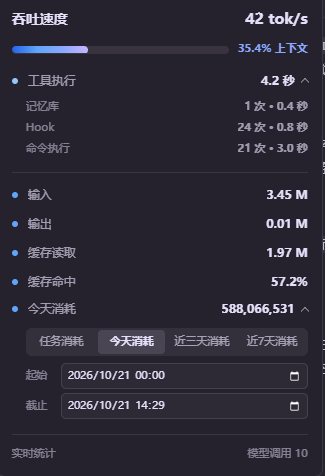

# TokenLens for Codex

在 Codex++ 底栏显示实时 `tok/s`，悬停查看本轮吞吐、工具分类、Token 与缓存，以及 Codex 会话的累计消耗。

  


## 功能

- 底栏显示实时 `tok/s` 和缓存命中
- 查看上下文占用、输入、输出、缓存读取与缓存命中
- 工具执行按记忆库、Skills、MCP、Hook、命令执行等类别汇总
- 支持任务、今天、近三天、近 7 天和自定义区间消耗
- 单文件外置脚本，无需重新构建 Codex++

## 安装

需要先安装 [Codex](https://chatgpt.com/codex) 和 [Codex++](https://github.com/BigPizzaV3/CodexPlusPlus)。

### Windows

在 PowerShell 中运行：

```powershell
New-Item -ItemType Directory -Force "$env:APPDATA\Codex++\user_scripts" | Out-Null
Invoke-WebRequest "https://raw.githubusercontent.com/LingYingNX/TokenLens-for-Codex/main/tokenlens.js" -OutFile "$env:APPDATA\Codex++\user_scripts\tokenlens.js"
```

### macOS

```bash
mkdir -p "$HOME/.config/Codex++/user_scripts"
curl -fsSL "https://raw.githubusercontent.com/LingYingNX/TokenLens-for-Codex/main/tokenlens.js" -o "$HOME/.config/Codex++/user_scripts/tokenlens.js"
```

安装后重启 Codex++，或在 Codex++ 的「拓展」页面执行热重载。

## 说明

数据来自 Codex 本地事件与会话记录，不上传会话内容。页面刷新后，状态栏会在下一次模型或工具事件到达时恢复。
